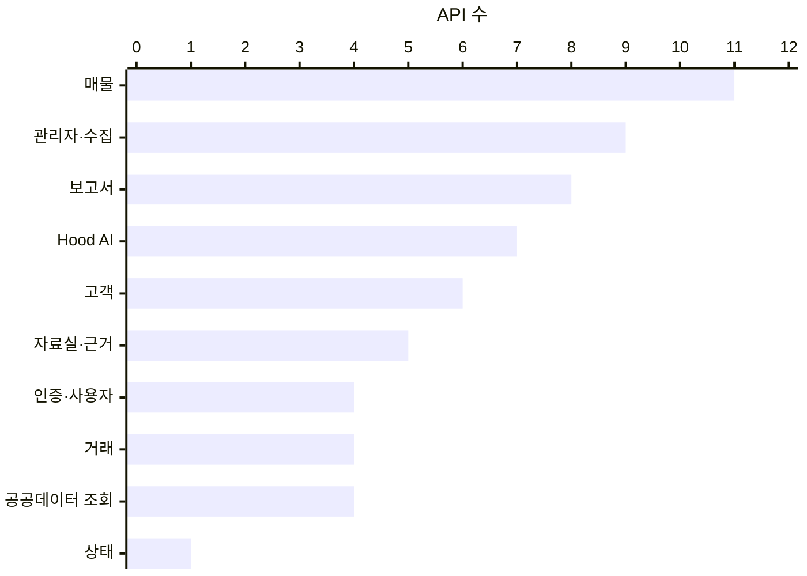

# 중개메이트 API 전체 목록 {#junggae-mate-api}

`/api` 아래 **59개 API**를 10개 분류로 나눴습니다. 로그인·회원가입·상태 확인을 뺀 모든 API에는 `Authorization: Bearer <JWT>` 헤더가 필요합니다. 결과는 로그인한 사무소의 자료로만 좁혀집니다.

- 토큰은 `POST /api/auth/login` 또는 `POST /api/auth/signup`이 돌려줍니다.
- `/api/admin/*`, `PUT /api/ai/settings`, `GET /api/audit`는 관리자만 부를 수 있습니다.
- 매물·거래·보고서를 바꾸는 API는 담당 중개사나 관리자만 부를 수 있고, 그 밖의 사용자는 403을 받습니다.

@answer scope="ccc8778 기준 backend/app/api.py · main.py · 서버 주소는 화면 config.json의 apiUrl"
@meta locale=ko repo_url=https://github.com/seandoesdev/junggae-mate.git repo_revision=ccc8778e03ff6f94b7cd92850e1b4cdf6a70c525
@source auth-routes title="로그인·회원가입 API" path=backend/app/api.py lines=282:318
@source require-admin title="관리자 확인 require_admin" path=backend/app/security.py lines=80:83
@source own-listing title="매물 담당 확인" path=backend/app/api.py lines=230:235
@source search-in title="질문 입력 SearchIn" path=backend/app/api.py lines=139:144
@source share-days title="공유 링크 7일" path=backend/app/workflow.py lines=284:300
@source main-routes title="API 밖 경로" path=backend/app/main.py lines=97:125

## 분류마다 API가 몇 개인가요? {#api-overview span=12}

| 권한 | 뜻 |
| --- | --- |
| 공개 | 토큰 없이 부를 수 있습니다. |
| 로그인 | 같은 사무소 사용자면 누구나 부를 수 있습니다. |
| 담당·관리자 | 그 매물·거래·고객의 담당 중개사나 관리자만 부를 수 있습니다. |
| 관리자 | `role=admin` 사용자만 부를 수 있습니다. |

## 인증·사용자 {#api-auth span=12}

| API | 권한 | 하는 일 |
| --- | --- | --- |
| `POST /api/auth/login` {#api-1} | 공개 | 이메일·비밀번호를 확인하고 JWT와 사용자 정보를 돌려줍니다. |
| `POST /api/auth/signup` {#api-2} | 공개 | 새 사무소와 그 관리자 계정을 만들고 바로 로그인합니다. 같은 이메일은 409, `SIGNUP_ENABLED=0`이면 403입니다. |
| `GET /api/me` {#api-3} | 로그인 | 내 이름, 역할, 사무소를 돌려줍니다. |
| `GET /api/agents` {#api-4} | 로그인 | 같은 사무소의 중개사 목록을 돌려줍니다. |

## 매물 {#api-listings span=12}

| API | 권한 | 하는 일 |
| --- | --- | --- |
| `GET /api/listings` {#api-5} | 로그인 | 매물 목록. `mine`, `sort=price\|recent`, `district`, `max_price`, `min_area`로 거릅니다. |
| `GET /api/listings/{listing_id}` {#api-6} | 로그인 | 매물 하나와 가격 이력, 메모, 확인 항목을 돌려줍니다. |
| `GET /api/listings/{listing_id}/public` {#api-7} | 로그인 | 연결된 공공데이터와 근거, 아직 연결하지 않은 후보를 돌려줍니다. 외부 API는 부르지 않습니다. |
| `PUT /api/listings/{listing_id}/links/{kind}` {#api-8} | 담당·관리자 | 후보 중 하나를 확정해 연결합니다. `kind`는 `complex`, `building`, `station`입니다. |
| `DELETE /api/listings/{listing_id}/links/{kind}` {#api-9} | 담당·관리자 | 확정한 연결을 풉니다. |
| `POST /api/listings/{listing_id}/notes` {#api-10} | 로그인 | 현장 메모를 남깁니다. Hood AI가 매물을 찾을 때 함께 봅니다. |
| `DELETE /api/listings/{listing_id}/notes/{note_id}` {#api-11} | 쓴 사람·관리자 | 메모를 지웁니다. |
| `PUT /api/listings/{listing_id}/checks/{key}` {#api-12} | 담당·관리자 | 거래 단계별 확인 항목을 체크하거나 해제합니다. |
| `POST /api/listings` {#api-13} | 로그인 | 매물을 등록합니다. 등록한 사람이 담당이 됩니다. |
| `PUT /api/listings/{listing_id}` {#api-14} | 담당·관리자 | 매물을 고칩니다. 가격이 바뀌면 이력에 남습니다. |
| `POST /api/listings/{listing_id}/close` {#api-15} | 담당·관리자 | 매물을 거래 종료로 바꿉니다. |

## 고객 {#api-customers span=12}

| API | 권한 | 하는 일 |
| --- | --- | --- |
| `GET /api/customers` {#api-16} | 로그인 | 고객 목록. `mine=true`면 내 고객만 돌려줍니다. |
| `GET /api/customers/{cid}` {#api-17} | 로그인 | 고객 조건, 활동 기록, 거래, 보고서를 돌려줍니다. |
| `POST /api/customers` {#api-18} | 로그인 | 고객과 희망 조건(예산, 면적, 지역, 역 거리, 생애최초 여부)을 등록합니다. |
| `PUT /api/customers/{cid}` {#api-19} | 로그인 | 고객 정보를 고칩니다. |
| `POST /api/customers/{cid}/activities` {#api-20} | 로그인 | 상담·연락 기록을 남깁니다. |
| `GET /api/customers/{cid}/matches` {#api-21} | 로그인 | 고객 조건에 맞는 매물을 돌려줍니다. |

## 거래 {#api-deals span=12}

| API | 권한 | 하는 일 |
| --- | --- | --- |
| `GET /api/deals` {#api-22} | 로그인 | 거래 목록과 단계별 머문 일수를 돌려줍니다. `mine=true`로 내 거래만 봅니다. |
| `POST /api/deals` {#api-23} | 로그인 | 고객에게 매물을 소개하면서 거래를 엽니다. 첫 단계는 소개(`intro`)입니다. |
| `POST /api/deals/{deal_id}/stage` {#api-24} | 담당·관리자 | 단계를 바꿉니다(`intro`→`visit`→`nego`→`contract`→`done`). 확인 항목이 남으면 경고를 함께 돌려줍니다. |
| `PUT /api/deals/{deal_id}` {#api-25} | 담당·관리자 | 다음 할 일(`next_action`)을 고칩니다. |

## 보고서 {#api-reports span=12}

| API | 권한 | 하는 일 |
| --- | --- | --- |
| `GET /api/reports` {#api-26} | 로그인 | 보고서 목록. `state=draft\|review\|done`으로 거릅니다. |
| `POST /api/customers/{cid}/reports` {#api-27} | 로그인 | 매물 비교(`compare`) 또는 문의 답변(`answer`) 보고서 초안을 근거와 함께 만듭니다. |
| `GET /api/reports/{rid}` {#api-28} | 로그인 | 보고서 본문, 확인할 사항, 출처, 공유 정보를 돌려줍니다. |
| `PUT /api/reports/{rid}` {#api-29} | 담당·관리자 | 의견과 확인할 사항을 고칩니다. |
| `POST /api/reports/{rid}/review` {#api-30} | 담당·관리자 | 검토를 요청합니다. |
| `POST /api/reports/{rid}/approve` {#api-31} | 담당·관리자 | 승인합니다. 출처·기준일을 확인했다는 `confirm=true`가 필요합니다. |
| `POST /api/reports/{rid}/share` {#api-32} | 담당·관리자 | 고객용 공유 링크(`/r/{token}`)를 만듭니다. 링크는 7일 뒤 만료됩니다. |
| `GET /api/reports/{rid}/export` {#api-33} | 로그인 | 인쇄·PDF 저장용 HTML을 돌려줍니다. |

## Hood AI {#api-hood span=12}

| API | 권한 | 하는 일 |
| --- | --- | --- |
| `POST /api/search` {#api-34} | 로그인 | 질문 하나로 매물·실거래·공공데이터·문서를 찾아 근거 번호가 붙은 답변을 돌려줍니다. 입력은 `q`, `drop`, `session_id`, `exclude_types`입니다. |
| `GET /api/ai/sessions` {#api-35} | 로그인 | 내 대화 목록을 돌려줍니다. |
| `GET /api/ai/sessions/{sid}` {#api-36} | 로그인 | 대화 하나의 질문과 답변을 순서대로 돌려줍니다. |
| `DELETE /api/ai/sessions/{sid}` {#api-37} | 로그인 | 내 대화를 지웁니다. |
| `GET /api/ai/settings` {#api-38} | 로그인 | 사무소 설정(검색할 문서 유형, 자세히 보여 줄 매물 수, 월 한도)과 이번 달 사용량을 돌려줍니다. |
| `PUT /api/ai/settings` {#api-39} | 관리자 | 사무소 설정을 바꿉니다. |
| `GET /api/ai/usage` {#api-40} | 로그인 | 최근 7~31일 질문 수, 경로별 질문 수, 응답 시간을 돌려줍니다. |

## 자료실·근거 {#api-library span=12}

| API | 권한 | 하는 일 |
| --- | --- | --- |
| `GET /api/documents` {#api-41} | 로그인 | 검색 대상 문서 목록. `type=law\|policy\|office\|news`로 거릅니다. |
| `POST /api/documents` {#api-42} | 로그인 | 중개사가 직접 적은 사무소 자료를 저장하고 바로 검색 색인에 넣습니다. 우리 사무소에서만 검색됩니다. |
| `DELETE /api/documents/{doc_id}` {#api-43} | 쓴 사람·관리자 | 사무소 자료를 지웁니다. |
| `GET /api/evidence/search` {#api-44} | 로그인 | 문서 조각을 하이브리드 검색으로 찾습니다. `q`, `type`을 받습니다. |
| `GET /api/evidence/{chunk_id}` {#api-45} | 로그인 | 근거 조각 하나의 원문 위치와 본문을 돌려줍니다. |

## 관리자·수집 {#api-admin span=12}

| API | 권한 | 하는 일 |
| --- | --- | --- |
| `POST /api/admin/documents` {#api-46} | 관리자 | PDF·텍스트 문서를 올려 검색 색인에 넣습니다. `scope=public`이면 모든 사무소가, `tenant`면 우리 사무소만 검색합니다. |
| `GET /api/admin/jobs` {#api-47} | 관리자 | 문서 등록·공공데이터 수집 작업 최근 50건과 결과를 돌려줍니다. |
| `DELETE /api/admin/documents/{doc_id}` {#api-48} | 관리자 | 우리 사무소 문서와 원문 파일을 지웁니다. |
| `POST /api/admin/collect/trades` {#api-49} | 관리자 | 아파트 매매 실거래가를 법정동 코드(`lawd_cd`)와 계약 연월(`deal_ymd`)로 수집합니다. |
| `POST /api/admin/collect/rents` {#api-50} | 관리자 | 아파트 전월세 실거래가를 같은 방식으로 수집합니다. |
| `POST /api/admin/collect/complexes` {#api-51} | 관리자 | K-apt 단지 기본 정보를 단지 코드(`kapt_code`)로 수집합니다. |
| `POST /api/admin/collect/buildings` {#api-52} | 관리자 | 건축물대장 표제부를 시군구·법정동 코드로 수집합니다. |
| `POST /api/admin/collect/subway-stations` {#api-53} | 관리자 | 지하철역 정보를 역 이름으로 수집합니다. |
| `GET /api/audit` {#api-54} | 관리자 | 로그인, 단계 변경, 승인, 공유 같은 감사 기록을 돌려줍니다. `entity_id`로 거릅니다. |

## 공공데이터 조회 {#api-public-data span=12}

수집해 둔 자료만 읽습니다. 이 API들은 공공데이터포털을 부르지 않습니다.

| API | 권한 | 하는 일 |
| --- | --- | --- |
| `GET /api/public-data/rents` {#api-55} | 로그인 | 법정동 코드(5자리)와 단지 이름으로 전월세 사례를 돌려줍니다. |
| `GET /api/public-data/complexes/{kapt_code}` {#api-56} | 로그인 | K-apt 단지 정보(세대수, 난방, 사용승인일)를 돌려줍니다. |
| `GET /api/public-data/buildings` {#api-57} | 로그인 | 시군구·법정동 코드로 건축물대장 표제부를 돌려줍니다. |
| `GET /api/public-data/subway-stations` {#api-58} | 로그인 | 역 이름으로 역과 노선을 찾습니다. `limit`은 1~200입니다. |

## 상태·API 밖 경로 {#api-system span=12}

| API | 권한 | 하는 일 |
| --- | --- | --- |
| `GET /api/health` {#api-59} | 공개 | DB, 벡터 확장, LLM 사용 여부를 확인합니다. |
| `GET /r/{token}` {#api-60} | 공개 | 고객이 공유 링크로 보고서를 엽니다. 만료된 링크는 열리지 않습니다. |
| `GET /config.json` {#api-61} | 공개 | 서버가 화면을 직접 내려 줄 때 `{"apiUrl": ""}`를 돌려줍니다. Cloudflare에서는 Pages Function이 대신 답합니다. |
| `GET /` {#api-62} | 공개 | `/app.html`로 보냅니다. |
| `GET /{name}` {#api-63} | 공개 | 화면 정적 파일을 내려 줍니다. 허용하지 않은 확장자와 폴더 밖 경로는 404입니다. |

API 밖 경로는 `main.py`에 있습니다. 서버의 FastAPI 자동 문서(`/docs`)에서 `/api` 경로를 직접 호출해 볼 수 있습니다.
