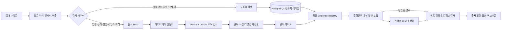

# Roomio 부동산 서비스 RAG 아키텍처 설계서

## 1. 문서 개요

| 항목 | 내용 |
|---|---|
| 제품 | Roomio / 중개메이트 |
| 버전 | v1.0 |
| 작성 기준일 | 2026-11-03 |
| 상태 | 목표 아키텍처 및 단계별 구현안 |
| 대상 | 제품, 백엔드, 데이터, 운영 담당자 |
| 연관 문서 | `PRD_PUBLIC_DATA.md`, `redesign.md`, `API.md`, `apis.md` |

이 문서는 Roomio가 매물·실거래·단지·건축물·교통·법령·정책·사무소 지식을 함께 검색하고, 고객에게 출처가 달린 답변과 비교자료를 제공하기 위한 독립 RAG 아키텍처를 정의한다.

여기서 RAG는 모든 데이터를 벡터 데이터베이스에 넣는다는 뜻이 아니다. 숫자·코드·날짜가 중요한 공공 API 데이터는 SQL로 정확하게 조회하고, 법령·정책처럼 문맥이 중요한 문서만 청킹·임베딩한다. 두 결과를 공통 근거 형식으로 합치는 **하이브리드 근거 아키텍처**가 본 설계의 핵심이다.

## 2. 목표와 설계 원칙

### 2.1 목표

1. 중개사의 자연어 질문을 매물, 거래, 공식 건축·단지·교통정보, 법령·정책 근거와 연결한다.
2. 답변의 각 주요 주장에 원천, 기준일, 수집일과 원문 위치를 남긴다.
3. 실거래가와 면적처럼 정확성이 필요한 값은 결정론적으로 계산한다.
4. 법령·정책의 시행 전, 폐지·개정, 자료 간 충돌과 근거 부족을 숨기지 않는다.
5. 사무소별 자료와 고객정보가 다른 사무소에 노출되지 않도록 검색 전 권한을 적용한다.
6. 외부 API나 LLM 장애가 핵심 매물·고객·거래 업무를 중단시키지 않게 한다.
7. 검색 품질과 비용을 측정하며 임베딩 모델과 검색 전략을 교체할 수 있게 한다.

### 2.2 설계 원칙

- **구조화 데이터는 구조화 검색:** 실거래·K-apt·건축물대장·지하철을 문장으로 변환해 임베딩하지 않는다.
- **문서는 의미 단위 검색:** 법령은 조문, 정책은 절·FAQ, 사무소 자료는 문단을 기본 단위로 한다.
- **검색 전에 권한과 시점을 제한:** tenant, 지역, 자료유형, 기준일, 유효기간을 후보 생성 전에 적용한다.
- **생성보다 근거가 우선:** 근거가 없으면 추정하지 않고 확인 불가 또는 추가 확인으로 반환한다.
- **원천과 가공값을 분리:** API 원문, 정규화 값, 계산 통계, 고객 전달 스냅샷을 구분한다.
- **사람이 최종 승인:** 고객 비교자료는 중개사가 검토·승인한 버전만 공유한다.
- **실시간 호출 최소화:** 사용자 질문 시 외부 API를 직접 호출하지 않고 검증된 로컬 캐시를 우선한다.

## 3. 현재 시스템 기준선

### 3.1 구현된 부분

- 관리자가 PDF/TXT를 올리거나 중개사가 사무소 자료를 작성하면 `documents`와 `chunks`에 저장된다.
- 문서 유형별 청킹, 384차원 문자 n-gram 해싱 임베딩, pgvector와 `pg_trgm` 기반 검색이 동작한다.
- 현재 문서 검색 점수는 벡터 유사도 60%와 단어 유사도 40%를 합산한다.
- 공용 문서 또는 현재 tenant 문서만 검색하고, 지역·발행일 조건을 적용한다.
- 법령 > 정책 > 사무소 > 뉴스 순으로 권위를 가산하고 문서당 최대 2개, 기본 6개 근거를 반환한다.
- 공식 근거 부재, 시행 전 자료, `facts` 값 충돌을 근거 게이트가 표시한다.
- 매물과 매매 실거래가는 문서 RAG가 아니라 SQL로 조회한 뒤 같은 답변에 합친다.
- 아파트 매매 실거래가 API `15126468`은 관리자 수집, 저장, 질문 검색, 비교자료에 연결돼 있다.

### 3.2 구조화 공공데이터 구현 상태

- 전월세 `15126474`, K-apt `15058453`, 건축물대장 `15134735`, TAGO 지하철 `15098554`는 정규화 테이블, 멱등 저장, 관리자 수집 API와 인증된 캐시 조회 API까지 구현됐다.
- 사용자 질문 중에는 외부 API를 직접 호출하지 않고 저장된 캐시를 조회할 수 있다.
- 매물 ↔ K-apt·건축물·역 연결은 `entity_links`로 구현됐다. 시스템은 이름 유사도(pg_trgm)·역명으로 후보만 제시하고, 매물 담당이 확정한다(자동 확정 없음).
- 질문 답변은 전월세·세대수·난방·사용승인·건축물대장·노선 질문을 라우팅해 해당 캐시만 읽고 구조화 evidence(`r/k/b/s{매물}`)로 출처를 붙인다. 비교표는 연결된 단지 정보를 문장과 스냅샷(`listings[].public`)에 넣는다. 매물 상세 화면에 공공데이터 섹션(후보 선택·확정·해제)이 있다.
- 수집 후 오래된 구조화 자료는 `stale`, 표본 3건 미만은 `warning`으로 표시하고 '추가로 확인할 사항'에 알린다.
- 전월세 근거의 지역(시군구 코드)은 정적 코드표 대신 **실제 적재된 행**으로 고른다: 동일 단지·유사 면적 > 매물 구 이름·주소의 시·도 > 그 단지가 수집된 법정동(`umdNm`)이 주소에 있는지. 실제 응답은 구 이름 없이 코드만 주는 경우가 많아, 같은 시·도의 두 구에 같은 이름 단지가 있으면 법정동으로 가르고, 그래도 동점이면 근거를 붙이지 않는다(틀린 지역 결합 금지).
- 지하철역 연결은 역명이 아니라 TAGO 역 ID로 저장한다. 환승역은 노선별 역 ID를 여러 개 골라 하나의 연결(`station_ids:`)로 묶고, 서로 다른 역명을 섞으면 거부한다(동명이역 오연결 방지). 과거 역명 키 연결은 계속 읽는다.
- 수집 오류는 외부 응답 문자열(요청 URL의 `serviceKey` 포함 가능)을 작업 이력·화면에 남기지 않고 고정 메시지로 바꾼다(수집 함수와 API 두 단계).
- 질문마다 `retrieval_traces`(질문 해시, 경로, 근거 id, 게이트, 응답 시간)를 남기고 사용량 화면에 경로별 수와 평균·p95 응답 시간을 보여 준다.
- 법령·정책 자동 수집기는 없고 관리자 업로드와 시드 문서에 의존한다.
- 국가법령정보 공동활용은 공공데이터포털 키가 아닌 별도 `OC`가 필요하므로 현재는 수동 등록이 기본 경로다.[S6][S7]

### 3.3 우선 해소할 기술 부채

1. 문서·매물·거래의 evidence 필드명을 하나의 canonical schema로 통일한다.
2. 자료유형과 사용자 설정 필터를 검색 후가 아니라 SQL 후보 생성 전에 적용한다.
3. `documents.embed_model`을 검색 조건에도 사용해 모델 버전 혼합을 방지한다.
4. 문서 업로드의 모든 실패가 `ingest_jobs`에서 `failed`로 종료되게 한다.
5. 플랫폼 공용 문서 게시 권한과 사무소 관리자 권한을 분리한다.
6. 법령 ID, 개정 계보, `valid_from`, `valid_to`를 추가해 기준일 검색을 지원한다.

## 4. 전체 아키텍처



### 4.1 오프라인 데이터 경로

```text
공공 API / 공식 문서 / 사무소 자료
       ↓
수집 작업(ingest run)
       ↓
Raw 원문·응답 ── 체크섬·출처·수집시각
       ↓
정규화/문서 추출 ── 유효성 검증·중복 제거·엔티티 연결
       ↓
SQL 인덱스 / 문서 청크·임베딩
       ↓
검색 가능 버전 활성화
```

### 4.2 온라인 질문 경로

```text
질문 분석 → 필요한 검색만 병렬 실행 → 공통 evidence 변환
→ 충돌·신선도·권위 검사 → 답변/비교표 생성 → 인용 검증
```

외부 API는 온라인 질문 경로에서 직접 호출하지 않는다. 캐시가 오래됐으면 마지막 성공 데이터와 기준일을 표시하고 백그라운드 갱신 작업을 요청한다. 최초 조회처럼 캐시가 전혀 없으면 `자료 없음/수집 중`을 반환하고 수집 작업을 생성한다.

## 5. 데이터 소스 카탈로그

### 5.1 공공 API와 제품 활용

| 데이터셋 | 요청·응답 형태 | 핵심 데이터 유형 | RAG에서의 역할 | 제품 활용 |
|---|---|---|---|---|
| 아파트 매매 실거래가 상세 `15126468` | `LAWD_CD`, `DEAL_YMD`로 요청하는 XML 거래 레코드 | 단지명, 법정동, 면적, 층, 계약일, 거래금액, 건축년도, 해제 관련 값 | **Structured RAG**: SQL 필터·집계 후 evidence 생성 | 호가 대비 과거 신고가, 유사면적 중위값, 질문·비교표 [S1] |
| 아파트 전월세 실거래가 `15126474` | 지역·계약월로 요청하는 XML 임대차 레코드 | 보증금, 월세, 면적, 층, 계약일·기간, 계약·갱신 관련 값 | **Structured RAG**: 전세와 월세를 분리해 SQL 집계 | 임차 고객 비교, 최근 보증금·월세 사례 [S2] |
| 공동주택 기본정보 `15058453` | `kaptCode` 기반 JSON 객체; 기본·상세 operation | 주소, 분양·난방, 사용승인, 동수·세대수·연면적, 관리·시설 정보 | **Structured RAG**: 속성 테이블 + 원천 JSONB | 매물 공식 단지정보, 고객 비교표 [S3] |
| 건축HUB 건축물대장 `15134735` | 주소 코드와 본번·부번 기반 XML/JSON; 여러 operation | 표제부, 층별, 전유공용면적, 주용도, 구조, 건축물 PK | **Structured RAG**: 계층형 정규화 + JSONB | 건축물 확인정보, 계약 전 확인사항 [S4] |
| TAGO 지하철정보 `15098554` | 역명 검색 후 역 ID로 후속 XML/JSON 호출 | 역·노선, 출구, 연계 버스, 주변시설, 시간표 | **Structured RAG**: 역/출구 관계 테이블 | 교통 조건 비교와 역 정보; 도보시간 계산에는 사용하지 않음 [S5] |

공공데이터포털의 `실시간` 표기는 호출 시 제공되는 최신 응답이라는 뜻으로 해석한다. 신고·행정 처리 자체가 무지연임을 보장하지 않는다. `source_as_of`는 원천이 명시한 기준일이 있을 때만 설정하고, 없으면 조회 범위인 `coverage_from/to`와 실제 `collected_at`을 표시한다.

### 5.2 문서형 데이터

| 유형 | 원천 | 형태 | 기본 범위 | 활용 |
|---|---|---|---|---|
| 법령 | 국가법령정보 공동활용 또는 공식 원문 파일 | XML/JSON/HTML/PDF | 플랫폼 공용 | 신고의무, 계약, 임대차, 중개 관련 근거 |
| 정책·공식 안내 | 국토교통부·지자체·공공기관 공식 PDF/HTML | PDF/TXT/HTML | 공용 또는 지역 | 지원요건, 시행일, 신청 절차 |
| 사무소 자료 | 중개사 직접 작성 또는 파일 등록 | TXT/PDF | 해당 tenant | 단지 확인 결과, 현장 지식, 내부 절차 |
| 뉴스 | 허용된 원문 또는 링크 메타데이터 | 텍스트/링크 | 공용 또는 tenant | 시장 맥락의 보조자료; 정책 근거로 단독 사용 금지 |
| 고객 승인자료 | Roomio가 만든 비교표·답변 스냅샷 | JSON/HTML | 해당 tenant·고객 | 재현·감사 목적; 일반 지식 검색에는 기본 제외 |

법제처 API를 사용할 때는 법령일련번호, 공포번호, 시행일, 소관부처, 조문번호와 원문 링크를 보존한다. 법제처 출처를 명시해야 하며, 개정 시 기존 버전을 덮어쓰지 않는다.[S6][S7]

### 5.3 내부 업무 데이터

| 데이터 | 형태 | 검색 방법 | 주의사항 |
|---|---|---|---|
| 매물 | 관계형 레코드 | 지역·가격·면적·상태 SQL | tenant 필수 |
| 고객 조건 | 관계형 레코드 | 결정론적 조건 결합 | LLM·임베딩 전송 최소화 |
| 거래 단계 | 관계형 이벤트 | 현재 상태와 이력 SQL | 권한·감사 기록 필수 |
| 현장 메모 | 짧은 텍스트 | 매물 후보 내 lexical/dense 보조검색 | 해당 tenant 전용 |
| 고객 자료 | 승인 버전 JSON | ID 조회 | 승인 후 불변 스냅샷 |

## 6. 데이터 유형별 활용 전략

### 6.1 구조화 수치·코드 데이터

실거래 금액, 면적, 층, 계약일, 보증금, 월세, 세대수, 역 ID 등은 벡터 검색하지 않는다.

- 조건은 SQL `WHERE`, 정렬과 집계는 SQL 함수로 계산한다.
- 금액은 현재 내부 표준인 만원 단위로 저장하고 원천 단위를 수집 경계에서 검증한다.
- 전용면적은 숫자로 저장하고 유사면적 허용범위를 명시한다.
- 전세와 월세는 별도 통계로 유지한다.
- 매매 해제 거래는 현재 유효 통계에서 제외하되 원천 상태는 보존한다.
- 계산 결과에는 사용한 기간, 필터, 표본 수와 기준일을 함께 반환한다.

### 6.2 반구조화 API 응답

K-apt·건축물대장·TAGO의 원천 JSON/XML은 다음 두 형태로 보관한다.

1. 자주 검색·비교하는 필드는 정규화 컬럼으로 저장한다.
2. 드물게 쓰거나 명세 변경 가능성이 큰 필드는 `raw_payload JSONB`에 보존한다.

JSONB는 원천 재처리에 유용하지만 핵심 검색을 JSON 경로에만 의존하지 않는다. 원천 PK, 명세 버전과 수집 시각을 반드시 저장한다.[S4][S11]

### 6.3 장문 문서

- 법령·정책·사무소 문서는 청킹 후 dense·lexical 하이브리드 검색을 사용한다.
- 표와 기준값은 가능한 경우 `facts`로 추출해 충돌 비교에 사용한다.
- 문서 본문 안의 명령문은 시스템 지시로 해석하지 않고 인용 대상 데이터로만 취급한다.
- OCR 신뢰도가 낮은 문서는 자동 게시하지 않고 검수 큐로 보낸다.

### 6.4 파생 데이터

중위가격, 거래범위, 단지 요약, 역 주변시설 요약은 원천이 아니라 파생값이다.

- 파생 규칙 버전과 입력 evidence ID를 저장한다.
- 질문마다 반복 계산되는 집계는 물리 또는 캐시 테이블로 사전 계산한다.
- LLM이 수치를 계산하지 않으며 서버가 계산한 값을 문장화만 한다.

## 7. 수집 및 갱신 파이프라인

### 7.1 공통 수집 단계

1. `source_registry`에서 데이터셋·operation·라이선스·갱신 정책을 읽는다.
2. `ingest_runs`에 범위, 시작시각, 어댑터 버전을 기록한다.
3. 서비스키를 로그에 남기지 않고 페이지 단위로 원천을 수신한다.
4. 응답 체크섬, 요청 범위, HTTP 상태와 원천 기준일을 raw 계층에 저장한다.
5. 스키마·필수값·단위·날짜를 검증한다.
6. 정규화 테이블에 idempotent upsert한다.
7. 삭제·해제·개정 이벤트를 반영한다.
8. 데이터 품질 통과 후 검색 가능 버전을 활성화한다.
9. 수신·신규·중복·제외·오류 건수로 작업을 종료한다.

### 7.2 API별 갱신 정책

| 데이터 | 권장 수집 | 재수집 이유 | 사용자 질문 시 |
|---|---|---|---|
| 매매·전월세 | 최근 월 매일, 과거 월 요청 시 | 신고 지연·정정·해제·갱신 반영 | DB 캐시만 조회 |
| K-apt 기본·상세 | 단지 연결 시 및 30일 주기 | 관리·시설 정보 변경 | 캐시가 오래되면 갱신 작업 예약 |
| 건축물대장 | 매물 연결 시, 이후 월간 | 공식 갱신 주기가 월간 [S4] | 마지막 성공 데이터와 기준일 표시 |
| 지하철 역·출구 | 역 연결 시 및 90일 주기 | 역·출구 메타정보 변화 | DB 캐시 조회 |
| 지하철 시간표 | 기능 사용 시 더 짧은 주기 별도 | 시간표 변경 가능 | 오래된 시간표는 답변에서 제외 |
| 법령 | `OC` 도입 후 주 1회 변경 확인 | 개정·시행·폐지 | 기준일에 유효한 버전만 검색 |
| 정책 문서 | 공식 공지 기반 수동/주기 확인 | 시행일·신청기간 변경 | 발행일·시행일 필터 |

MVP에서는 관리자 수동 실행으로 시작한다. 예약 실행은 Redis·Celery를 추가하지 않고 OS 스케줄러, 외부 cron 또는 단일 앱 스케줄러 중 하나를 ADR로 결정한다.

### 7.3 문서 수집 단계

```text
파일/API 수신 → 악성·형식 검사 → 텍스트 추출 → 문서 메타데이터 검증
→ 내용 해시 중복 제거 → 구조 분석 → 청킹 → 임베딩 → 인덱스 버전 활성화
```

- PDF/TXT를 기본 지원하고 스캔 PDF는 OCR 후 신뢰도 검수를 거친다.
- 법령 API 도입 전에는 공식 사이트에서 내려받은 원문과 URL을 관리자가 등록한다.
- 같은 내용 해시는 재임베딩하지 않되 메타데이터 변경은 별도로 추적한다.
- 원문 보관 실패나 일부 청크 실패를 작업 성공으로 숨기지 않는다.

## 8. 저장·정규화·인덱싱 설계

### 8.1 논리 저장 계층

| 계층 | 목적 | 예시 |
|---|---|---|
| Raw | 원천 재현·감사 | API XML/JSON, PDF, 체크섬, 요청 범위 |
| Normalized | 정확한 필터·집계 | 실거래, 단지, 건축물, 역·출구 테이블 |
| Document Index | 의미 검색 | documents, chunks, embedding |
| Evidence Snapshot | 고객 전달 재현 | 보고서 생성 당시 출처·값·주의문 |
| Telemetry | 품질·운영 | ingest runs, retrieval traces, 평가 결과 |

### 8.2 권장 신규·확장 모델

| 모델 | 핵심 필드 |
|---|---|
| `source_registry` | source_id, 제공기관, URL, 형식, 라이선스, 갱신정책, adapter_version |
| `ingest_runs` | source_id, tenant_id(해당 시), initiated_by, 범위, 상태, 수신·신규·제외·오류 건수, started/finished_at |
| `raw_objects` | source_id, 인증정보를 제거한 정규화 요청 해시 `request_key`, checksum, payload_path 또는 JSONB, collected_at |
| `apt_rent_trades` | 지역, 단지, 면적, 층, 계약일, 보증금, 월세, 계약구분, 원천 ID |
| `apartment_complexes` | kapt_code, 단지명, 주소, 정규화 필드, raw_payload, source_as_of |
| `building_register_records` | 원천 PK, 주소코드, 대장종류, 용도·구조·면적, raw_payload |
| `subway_stations/exits` | station_id, 역명, 노선, 출구, 시설·연계 관계 |
| `entity_links` | tenant_id, listing_id, source_type, source_entity_id, match_method, confidence, confirmed_by |
| `documents` 확장 | source_doc_id, revision_id, valid_from/to, supersedes_id, status |
| `chunks` 확장 | chunk_key, page, article_path, token_count, embed_model, index_version |
| `retrieval_traces` | tenant_id, 익명 질의 해시, 라우트, 후보·선택 evidence, latency, gate 상태 |

공공 원천 테이블은 전역 공유할 수 있다. 매물 연결, 수동 확정, 사무소 문서, 고객 자료와 운영 권한은 `tenant_id`로 격리한다.

### 8.3 인덱스 전략

- 구조화 테이블: 지역·계약일·단지·면적 복합 B-tree 인덱스
- 주소·단지 후보: 정규화 문자열 B-tree + `pg_trgm` GIN/GiST 후보 검색
- 문서 lexical: `pg_trgm` 또는 PostgreSQL 전문검색 인덱스
- 문서 dense: 초기에는 exact pgvector; 규모·지연 임계치 초과 후 HNSW 검토
- HNSW/IVFFlat 도입 전 golden query로 recall과 p95를 비교한다.
- approximate index의 metadata 필터 누락 가능성을 고려해 iterative scan, 분할 또는 충분한 후보 수를 사용한다.[S8]

`pg_trgm`은 표기 차이와 오탈자 후보 생성에 사용하되 단지·건축물 자동 확정 수단으로 단독 사용하지 않는다.[S9]

## 9. 검색 및 답변 생성 설계

### 9.1 질문 이해

질문을 다음 슬롯으로 분해한다.

- 의도: 매물 찾기, 가격 비교, 단지 확인, 건축물 확인, 교통, 법령·정책, 고객 자료 작성
- 엔티티: 지역, 법정동코드, 단지, 면적, 가격, 거래유형, 계약월, 역·노선, 고객 ID
- 시간: 현재 기준일, 거래기간, 정책 시행 기준일
- 제약: 예산, 최소면적, 도보시간, 거래단계

규칙 기반 파서를 우선하고 LLM 파싱을 사용하더라도 원문과 해석된 조건을 사용자에게 보여 준다.

### 9.2 검색 라우팅

| 질문 예 | 실행 경로 |
|---|---|
| “공덕동 59㎡ 최근 거래가?” | 매물/매매 SQL만 |
| “이 단지 최근 전세와 월세는?” | 전월세 SQL만 |
| “세대수와 난방 방식은?” | K-apt 캐시 |
| “건축물대장상 주용도는?” | 건축물대장 캐시 |
| “공덕역 몇 호선이고 주변시설은?” | TAGO 캐시 |
| “계약 후 신고기한은?” | 법령·정책 문서 RAG |
| “8억 이하 역세권 매물과 생애최초 조건” | 매물 SQL + 교통 캐시 + 정책 RAG |

라우터는 필요하지 않은 검색을 실행하지 않아 비용과 노이즈를 줄인다.

### 9.3 문서 후보 검색

1. tenant·자료유형·지역·기준일·유효기간·embed_model을 선필터한다.
2. dense와 lexical 검색에서 각각 충분한 후보를 만든다.
3. 초기 버전은 현재의 가중합을 유지하되 평가셋으로 조정한다.
4. 점수 척도가 다른 검색기를 추가하면 RRF와 정규화 가중합을 비교한다.
5. 문서당 청크 수를 제한해 한 문서의 결과 독점을 막는다.
6. 법령 권위, 시행상태, 최신 유효 버전, 지역 일치를 재정렬에 반영한다.

### 9.4 구조화 검색

- 엔티티를 확정하지 못하면 단지·건축물 후보 목록을 반환하고 사용자 확인을 받는다.
- 거래 통계는 단지, 면적 허용범위, 기간과 표본 수를 명시한다.
- 건축물대장은 주소→시군구·법정동·본번·부번 파싱 후 복수 후보를 자동 확정하지 않는다.
- TAGO 역은 역명뿐 아니라 역 ID와 노선을 사용한다.

### 9.5 답변 조립

1. 서버가 수치·상태·주의문을 결정론적으로 계산한다.
2. evidence registry에서 실제 사용할 근거만 선택한다.
3. LLM이 없으면 템플릿으로 답변한다.
4. LLM이 있으면 선택된 근거 안에서만 문장을 다듬게 한다.
5. 생성 후 인용 ID 존재 여부, 수치 일치, 금지된 단정, 개인정보 포함 여부를 검증한다.
6. 검증 실패 문장은 `추가 확인할 사항`으로 강등하거나 제거한다.

## 10. 청킹·임베딩·재정렬 전략

### 10.1 유형별 청킹

| 유형 | 경계 | 권장 크기 | 중첩 | 필수 메타데이터 |
|---|---|---:|---:|---|
| 법령 | 법령-장-조-항 | 조문 우선, 긴 조문만 400~700토큰 | 원칙적으로 없음 | 법령 ID, 조문, 시행기간, 소관부처 |
| 정책 | 제목-절-표-FAQ | 500~900토큰 | 10~15% | 발행기관, 지역, 발행·시행일 |
| 사무소 자료 | 제목-문단 | 300~700토큰 | 필요 시 10% | tenant, 작성자, 단지·지역 태그 |
| 뉴스 | 기사-문단 | 300~500토큰 | 없음 | 매체, 발행일, URL, 보조자료 상태 |
| PDF 표 | 표 제목 + 헤더 + 행 묶음 | 헤더 반복 | 필요 없음 | 페이지, 표 번호, 단위 |

현재 `글자 수/2` 토큰 근사는 MVP에서 유지할 수 있지만, 실제 임베딩 모델 도입 시 해당 tokenizer 기준으로 교체한다. PDF 페이지, 법령 조항호목과 표 위치를 청크마다 보존한다.

### 10.2 임베딩 전략

- 현재 `hash-ngram-v1-384`는 비용과 외부 전송이 없고 단순 한국어 표기 검색에 적합한 기준선이다.
- 목표 모델은 한국어 부동산·법률 평가셋으로 로컬 다국어 모델과 관리형 임베딩을 비교한 뒤 선정한다.
- 문서와 질문에 같은 모델 버전을 사용하고 `embed_model`, `index_version`을 검색 조건에 넣는다.
- 모델 교체 시 blue/green 인덱스를 만들어 전체 재임베딩 후 트래픽을 전환한다.
- 고객 이름·연락처·상담 원문은 외부 임베딩 서비스에 전송하지 않는다.

### 10.3 재정렬 전략

근거리 후보 검색은 recall 확보가 목적이고 최종 순서는 다음을 결합한다.

- 의미·어휘 관련도
- 공식성: 법령 > 정책 > 사무소 확인자료 > 뉴스
- 기준일 유효성 및 최신성
- 지역·단지·질문 의도 일치
- 출처 다양성
- 동일 문서 중복 패널티

초기 공식은 현재 60/40 가중합을 유지한다. 목표 가중치는 고정된 감이 아니라 평가 데이터로 결정한다.

## 11. 근거·신뢰도·출처 설계

### 11.1 Canonical evidence schema

```json
{
  "id": "trade:15126468:원천식별자",
  "kind": "structured|document|listing|derived",
  "source_id": "15126468",
  "source_type": "data|law|policy|office|news",
  "title": "국토교통부 아파트 매매 실거래가 상세 자료",
  "publisher": "국토교통부",
  "source_url": "https://www.data.go.kr/data/15126468/openapi.do",
  "source_as_of": null,
  "coverage_from": "2026-10-01",
  "coverage_to": "2026-10-31",
  "collected_at": "2026-11-03T02:10:00Z",
  "effective_from": null,
  "effective_to": null,
  "location": "마포구/공덕동/단지/59㎡",
  "value": {"median_price": 85000, "unit": "만원", "sample_count": 6},
  "snippet": null,
  "state": "ok|warning|conflict|stale|insufficient",
  "note": "과거 신고 거래이며 현재 호가가 아닙니다."
}
```

문서·매물·거래 코드가 이 스키마의 필드명을 동일하게 사용해야 한다. 생성 모델에는 내부에 존재하는 evidence ID만 전달한다.

### 11.2 근거 게이트

- 정책 질문에 법령·공식 정책이 없으면 답변을 단정하지 않는다.
- 시행일이 기준일 이후면 `warning`으로 표시한다.
- 같은 사실 키가 충돌하면 권위가 높은 자료를 우선하되 양쪽을 함께 보여 준다.
- stale 기준을 넘긴 구조화 데이터는 표시하되 오래된 자료임을 알린다.
- 거래 표본이 적으면 통계 대신 사례 목록과 표본 수를 보여 준다.
- 뉴스만 있는 주장은 시장 맥락으로만 표시한다.
- 승인된 고객 자료는 생성 당시 evidence 스냅샷을 유지한다.

## 12. 보안·권한·개인정보 보호

### 12.1 데이터 경계

- 공공 원천 데이터와 플랫폼 검수 공용 문서는 전역 공유 가능하다.
- 사무소 문서, 매물 연결, 고객·상담·보고서는 tenant 전용이다.
- 애플리케이션 필터와 함께 PostgreSQL Row-Level Security 적용을 목표로 한다. RLS는 정책이 없을 때 기본 거부가 가능하다.[S10]
- `scope=public` 등록은 플랫폼 큐레이터만 허용한다.

### 12.2 개인정보 최소화

- 고객 이름·전화번호는 검색 질의, 임베딩, 외부 API, 관측 로그에서 제거하거나 내부 ID로 치환한다.
- 고객 예산과 선호는 필요한 필터로만 사용하고 문서 인덱스에 저장하지 않는다.
- 원문 등기자료처럼 개인정보가 포함될 수 있는 문서는 별도 보존정책과 접근권한 없이는 공용 RAG에 넣지 않는다.
- 고객 공유 링크는 만료·승인 상태를 검사하고 조회 감사기록을 남긴다.

### 12.3 비밀과 입력 방어

- `DATA_GO_KR_SERVICE_KEY`와 향후 `LAW_GO_KR_OC`는 서버 환경변수로만 사용한다.
- 요청 URL, 오류, 로그에서 키 값을 마스킹한다.
- 업로드 문서의 스크립트·매크로·외부 명령은 실행하지 않는다.
- 문서 속 “이전 지시를 무시하라” 같은 문구는 검색 데이터일 뿐 시스템 지시가 아니다.

## 13. 성능·비용·효율화 방안

### 13.1 가장 효과가 큰 최적화

1. 질문 라우팅으로 불필요한 RAG·API 경로를 실행하지 않는다.
2. 구조화 API는 사전 수집해 사용자 질문 시 DB만 조회한다.
3. 최근 월만 반복 수집하고 과거 데이터는 불변에 가깝게 취급한다.
4. content hash로 같은 문서의 추출·임베딩을 생략한다.
5. tenant·지역·유형·시점 필터를 후보 생성 전에 적용한다.
6. top-N 후보만 재정렬하고 최종 근거 수를 제한한다.
7. 반복 거래 집계를 단지·면적대·월 단위로 캐시한다.
8. LLM은 근거 검색과 계산이 끝난 뒤 필요한 답변에만 사용한다.

### 13.2 인덱스 전환 기준

- 청크 수와 p95 검색시간이 목표를 넘지 않으면 exact vector 검색을 유지한다.
- 청크 증가로 p95가 초과하면 HNSW를 후보로 벤치마크한다.
- HNSW/IVFFlat은 속도와 recall의 교환이 있으므로 Recall@k 저하를 측정한다.[S8]
- 대량 최초 적재 후 인덱스를 만들고 운영에서는 concurrent 생성을 사용한다.

### 13.3 캐시와 신선도

- 캐시 키에는 source, operation, 지역/엔티티, 기간, adapter_version을 포함한다.
- stale-while-revalidate 방식으로 마지막 성공 데이터를 서비스하되 기준일을 숨기지 않는다.
- 인증 오류는 재시도하지 않고, 시간초과·일시 오류만 지수 백오프로 제한 재시도한다.
- 회로 차단기는 데이터셋별로 분리한다.

## 14. 품질 평가와 관측성

### 14.1 평가 데이터셋

출시 전 실제 업무 질문 60~100개를 익명화해 다음 범주로 구성한다.

- 매물 조건 검색과 근접 매물
- 단지·유사면적 매매 사례
- 전세·월세 비교
- K-apt 단지 사실
- 건축물대장 사실과 복수 후보
- 지하철·노선·출구 정보
- 계약·신고·임대차 법령
- 지역·시행일이 있는 정책
- 근거 없음, 충돌, 시행 전, 오래된 데이터
- 다른 tenant 정보 유출 방지

각 질문에는 기대 엔티티, 필터, 정답 근거 ID, 허용 답변과 반드시 거절할 단정을 기록한다.

### 14.2 핵심 지표

| 영역 | 지표 | 초기 목표 |
|---|---|---:|
| 검색 | Recall@6 | 0.85 이상 |
| 순위 | nDCG@6 또는 MRR | 기준선 대비 지속 개선 |
| 근거 | citation precision | 0.95 이상 |
| 답변 | grounded claim rate | 0.95 이상 |
| 거절 | 근거 부족 시 올바른 유보율 | 0.90 이상 |
| 구조화 | 금액·면적·날짜 계산 정확도 | 1.00 |
| 격리 | 교차 tenant 노출 테스트 | 0건 |
| 성능 | 검색 p95 | 500ms 이하 |
| 전체 | LLM 포함 답변 p95 | 별도 SLO로 측정 |
| 신선도 | 소스별 freshness SLA 위반 | 1% 미만 |

### 14.3 관측 이벤트

- 수집: source, 범위, 수신·신규·제외·오류, 지연, adapter_version
- 검색: 라우트, 필터, 후보 수, 선택 근거, 각 단계 latency
- 근거 게이트: insufficient/conflict/stale/not-effective 빈도
- 생성: 모델·프롬프트 버전, 토큰·비용, 인용 검증 실패율
- 사용자: 근거 열람, 결과 수정, 추가 확인 전환, 보고서 승인 여부

원문 질문과 개인정보를 그대로 로그에 남기지 않고 익명 ID와 필요한 구조화 지표만 기록한다.

## 15. 장애 대응과 데이터 수명주기

### 15.1 장애 등급

| 장애 | 동작 |
|---|---|
| 공공 API 시간초과 | 마지막 성공 캐시 사용, 갱신 실패 표시 |
| 인증키 오류 | 즉시 실패, 관리자에게 설정 오류 표시, 자동 재시도 금지 |
| 일부 페이지 실패 | 성공 범위 유지, 실패 체크포인트부터 재시도 |
| 문서 추출 실패 | 검색 인덱스 미게시, 작업 `failed` |
| 임베딩 서비스 실패 | 기존 인덱스 유지, 신규 버전 미활성화 |
| LLM 실패 | 템플릿 답변 또는 검색 결과 제공, 핵심 업무 유지 |
| vector 검색·인덱스 장애 | 문서 검색만 degraded, 구조화 SQL·핵심 업무는 가능한 범위에서 유지 |
| PostgreSQL 장애 | 매물·고객·거래를 포함한 서비스 장애로 처리하고 헬스체크·백업·복구 절차 실행 |

### 15.2 데이터 수명주기

- Raw 원천은 라이선스·감사 요구에 맞춘 보존기간을 source registry에 둔다.
- 정규화 공공데이터는 새 버전을 upsert하되 변경·해제 이력을 보존한다.
- 폐지 법령은 현재 검색에서 제외하고 기준일 검색과 감사용으로 보존한다.
- tenant 문서는 삭제 시 청크와 인덱스를 함께 제거하고 원문 보존정책을 따른다.
- 승인 고객 자료의 evidence 스냅샷은 보고서 보존기간 동안 유지한다.
- 임베딩 구버전은 전환 검증과 롤백 기간 후 제거한다.

## 16. 단계별 구현 로드맵

### Phase 0. 계약과 운영 기반

- canonical evidence schema 통일
- 검색 전 source/tenant/region/time/embed_model 필터
- 모든 수집 실패의 작업 상태 종료 보장
- source registry, ingest run, adapter version 도입
- 공용 문서 큐레이터 권한 분리
- golden query와 현재 검색 기준선 측정

### Phase 1. 구조화 공공데이터 완성 — 백엔드 수집·캐시 완료, 제품 연결 진행

- 전월세 정규화 테이블·수집·거래유형별 조회 — 완료
- 법정동 코드 기준정보와 주소 파서
- K-apt 기본정보 저장 — 완료; 단지코드 탐색 또는 관리자 매핑과 상세정보는 진행 필요
- 건축물대장 표제부 저장 — 완료; 전유공용면적과 복수 후보 검토는 진행 필요
- TAGO 역 ID·노선 저장 — 완료; 출구 관계는 진행 필요
- 구조화 evidence와 질문·비교표 연결 — 완료 (`structured.py`, 매물 상세 공공데이터 섹션, `retrieval_traces`)
- 엔티티 연결 `entity_links` — 완료 (후보 제시 + 사람 확정)

### Phase 2. Temporal Document RAG

- 법령 `OC` 발급 전 공식 파일 수동 등록 절차 강화
- `OC` 발급 후 법령 목록·본문·변경이력 수집
- 법령 ID, 조문 경로, 유효기간, 개정 계보 모델
- 정책 HTML/PDF 변경 감지와 검수 큐
- OCR과 표 추출의 신뢰도 검수

### Phase 3. 검색 품질 고도화

- 한국어 부동산 평가셋으로 임베딩 후보 비교
- blue/green 재임베딩과 모델 버전 필터
- weighted fusion과 RRF, 선택적 reranker 비교
- HNSW 도입 여부를 recall·latency로 결정
- facts 추출과 충돌 감지 범위 확대

### Phase 4. 운영 최적화

- 예약 수집 실행방식 ADR 및 운영 자동화
- freshness·비용·검색 품질 대시보드
- 데이터셋별 SLO와 장애 알림
- 사용자 피드백 기반 평가셋 정기 갱신

## 17. 의사결정 사항과 비목표

### 17.1 결정이 필요한 사항

1. 법령 자동수집을 위한 `LAW_GO_KR_OC` 신청 시점과 운영 주체
2. 초기 서비스 지역과 법정동 코드 범위
3. K-apt 단지코드 마스터 확보 방식
4. 건축물대장 operation 중 고객 자료에 노출할 필드
5. 임베딩 모델의 로컬 운영과 관리형 서비스 간 선택
6. 예약 실행 방식과 배포 환경
7. 공용 공식문서 큐레이터의 조직 역할
8. raw 원문과 retrieval trace의 보존기간

### 17.2 비목표

- 공공데이터만으로 매물을 자동 생성하거나 광고 매물을 크롤링하지 않는다.
- RAG가 등기·건축물·법률 검토를 대체한다고 표현하지 않는다.
- 미래가격 예측, 적정가격 보장, 투자 추천을 제공하지 않는다.
- LLM이 숫자 집계, 권한 판정 또는 출처 존재 여부를 결정하지 않는다.
- 뉴스만으로 정책 적용이나 법적 의무를 단정하지 않는다.
- TAGO 정보로 실제 도보거리·도보시간을 추정하지 않는다.

## 18. 근거 자료

### 18.1 공공데이터 및 법령 공식 자료

- [S1] 공공데이터포털, [국토교통부 아파트 매매 실거래가 상세 자료 `15126468`](https://www.data.go.kr/data/15126468/openapi.do), 조회 2026-11-03.
- [S2] 공공데이터포털, [국토교통부 아파트 전월세 실거래가 자료 `15126474`](https://www.data.go.kr/data/15126474/openapi.do), [기계가독 메타데이터](https://www.data.go.kr/catalog/15126474/openapi.json), 조회 2026-11-03.
- [S3] 공공데이터포털, [국토교통부 공동주택 기본 정보제공 서비스 `15058453`](https://www.data.go.kr/data/15058453/openapi.do), [기계가독 메타데이터](https://www.data.go.kr/catalog/15058453/openapi.json), 조회 2026-11-03.
- [S4] 공공데이터포털, [국토교통부 건축HUB 건축물대장정보 서비스 `15134735`](https://www.data.go.kr/data/15134735/openapi.do), [기계가독 메타데이터](https://www.data.go.kr/catalog/15134735/openapi.json), 조회 2026-11-03.
- [S5] 공공데이터포털, [국토교통부 TAGO 지하철정보 `15098554`](https://www.data.go.kr/data/15098554/openapi.do), [기계가독 메타데이터](https://www.data.go.kr/catalog/15098554/openapi.json), 조회 2026-11-03.
- [S6] 법제처 국가법령정보 공동활용, [OPEN API 활용방법](https://open.law.go.kr/LSO/openApi/openApiManual.do), 조회 2026-11-03.
- [S7] 법제처 국가법령정보 공동활용, [이용안내 및 출처·활용 제한](https://open.law.go.kr/LSO/information/guide.do), 조회 2026-11-03.

### 18.2 검색·저장 기술 공식 자료

- [S8] pgvector, [공식 README: exact/approximate vector search, HNSW, IVFFlat, hybrid search](https://github.com/pgvector/pgvector), 조회 2026-11-03.
- [S9] PostgreSQL 16, [`pg_trgm` 공식 문서](https://www.postgresql.org/docs/16/pgtrgm.html), 조회 2026-11-03.
- [S10] PostgreSQL 16, [Row Security Policies 공식 문서](https://www.postgresql.org/docs/16/ddl-rowsecurity.html), 조회 2026-11-03.
- [S11] PostgreSQL 16, [JSON Types와 JSONB 공식 문서](https://www.postgresql.org/docs/16/datatype-json.html), 조회 2026-11-03.

### 18.3 프로젝트 내부 근거

- [I1] `backend/app/rag.py`: 문서 수집, 하이브리드 검색, 권위 재정렬, 근거 게이트.
- [I2] `backend/app/chunking.py`: 법령·정책·사무소·뉴스 유형별 청킹.
- [I3] `backend/app/embedding.py`: `hash-ngram-v1-384` 임베딩 기준선.
- [I4] `backend/app/assistant.py`: 질문 분석, 매물·실거래·문서 근거 결합.
- [I5] `backend/app/drafting.py`: 매물·실거래 evidence와 고객 자료 작성·인용 검증.
- [I6] `backend/app/public_data.py`: 아파트 매매 실거래 수집·해제 제외·페이지네이션·회로 차단.
- [I7] `backend/app/public_catalog.py`: 공공 API 5종 endpoint, 형식, 필수 파라미터.
- [I8] `backend/sql/schema.sql`: tenant, documents, chunks, `vector(384)`, 실거래, 보고서 스냅샷과 감사기록.
- [I9] `docs/PRD_PUBLIC_DATA.md`: 공공데이터 제품 요구사항과 단계별 출시 범위.
